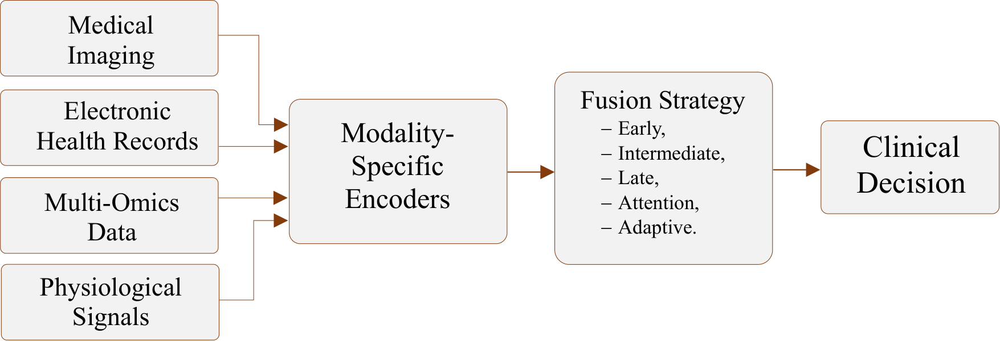

# MIFS-BDA: Multimodal Information Fusion Strategies for Biomedical Data Analysis

**Submitted to SOMET 2026** — New Trends in Intelligent Software Methodologies, Tools and Techniques (IOS Press, FAIA series)

---

## Overview

This paper reviews 36 studies (1997–2025) on fusion strategies for multimodal biomedical data — medical images, EHR, multi-omics, and physiological signals.

We propose a five-level fusion taxonomy and validate it experimentally on the VQA-RAD medical visual question answering dataset.



**Figure 1.** Multimodal data flows through modality-specific encoders into a fusion module (Early / Intermediate / Late / Attention / Adaptive) for clinical decision-making.

## Fusion Taxonomy

| Level | Strategy | Fusion Point | Missing Modality Robustness |
|-------|----------|--------------|-----------------------------|
| 1 | Early | Data-level concatenation | Poor |
| 2 | Intermediate | Feature-level (hidden layers) | Moderate |
| 3 | Late | Decision-level combination | Good |
| 4 | Attention-Based | Learnable cross-modal weighting | Moderate |
| 5 | Adaptive | Per-sample dynamic routing | Excellent |

## Experiment

**Dataset:** [VQA-RAD](https://osf.io/89kps/) — 3,515 QA pairs, 315 radiology images. Closed-ended (yes/no) subset only.

**Setup:** Nine methods share the same image encoder (EfficientNet-B0) and text encoder (embedding + GRU). Only the fusion module differs.

### Results (Table 5 in paper)

| Strategy | Model | F1 | Bal. Acc | Acc |
|----------|-------|-----|---------|-----|
| Baseline | ImageOnly | 0.561 | 0.561 | 0.561 |
| Baseline | TextOnly | 0.628 | 0.630 | 0.631 |
| Early | EarlyFusion | 0.672 | 0.672 | 0.673 |
| Intermediate | DeepFusion | 0.654 | 0.654 | 0.654 |
| Intermediate | LMF | 0.643 | 0.646 | 0.645 |
| Late | LateFusion | 0.672 | 0.674 | 0.673 |
| Attention | CrossAttn | 0.628 | 0.642 | 0.640 |
| Attention | GAF | 0.640 | 0.640 | 0.640 |
| **Adaptive** | **HybridFusion** | **0.691** | **0.692** | **0.692** |

Adaptive fusion (HybridFusion) achieves the highest F1. It adjusts modality weights per sample based on modality confidence.

### Robustness Under Image Masking (Table 6 in paper)

| Mask Ratio | F1 | Bal. Acc | Acc |
|------------|-----|---------|-----|
| 0.0 | 0.655 | 0.658 | 0.659 |
| 0.1 | **0.679** | **0.681** | **0.682** |
| 0.5 | 0.636 | 0.636 | 0.636 |
| 0.9 | 0.650 | 0.650 | 0.650 |

Even with 90% of image patches masked, F1 remains at 0.650. Light masking (10%) slightly improves performance — likely a regularization effect.

## Repository Structure

```
├── README.md
├── requirements.txt
├── LICENSE
├── src/
│   ├── models/
│   │   ├── __init__.py
│   │   ├── encoders.py
│   │   └── fusion.py
│   ├── dataset.py
│   └── run_experiment.py
├── figures/
│   ├── Figure_1.png
│   ├── draw_radar.py
│   ├── draw_performance.py
│   ├── radar_scores.csv
│   └── performance_data.csv
└── data/
    ├── table_vqarad.csv
    └── table_masking.csv
```

## How to Reproduce

### 1. Install dependencies

```bash
pip install -r requirements.txt
```

### 2. Download VQA-RAD dataset

Download from [the official VQA-RAD repository](https://osf.io/89kps/) and extract to `data/VQA_RAD/`.

Expected structure:
```
data/VQA_RAD/
├── VQA_RAD Dataset Public.json
└── VQA_RAD_Image_Folder/
    ├── synpic100132.jpg
    ├── ...
```

### 3. Run experiment

```bash
python src/run_experiment.py --data_dir data/VQA_RAD
```

### 4. Generate figures

```bash
python figures/draw_radar.py
python figures/draw_performance.py
```

## Requirements

-- Python 3.10+  
-- PyTorch 2.0+ (CUDA recommended)  
-- See `requirements.txt` for full list

## Citation

```bibtex
@inproceedings{nguyen2026multimodal,
  title     = {Multimodal Information Fusion Strategies for Biomedical Data Analysis},
  author    = {Nguyen, Ba-Duy and Hoang, Van-Dung and Vu, Sang and Huynh, Anh T},
  booktitle = {New Trends in Intelligent Software Methodologies, Tools and Techniques:
               Proceedings of the 25th International Conference on New Trends in
               Intelligent Software Methodologies, Tools and Techniques (SoMeT\_26)},
  pages     = {130--139},
  year      = {2026},
  organization = {SAGE Publications},
  doi       = {10.3233/FAIA260732}
}
```

## License

MIT License. See [LICENSE](LICENSE) for details.
